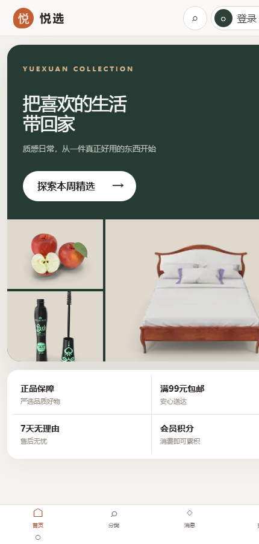

# Yuexuan Commerce — Full-Stack E-Commerce Demo

A complete e-commerce web application that runs locally: browsing, accounts, cart, checkout, orders, and a merchant back office — built with **Node.js and SQLite, no frameworks, no build step**.

`github.com/zyuhang960-cloud/yuexuan-commerce`

> **Demo video (1 min 40 s):** https://youtu.be/YzX1jz4FEFo




---

## What this is

A self-initiated project, built outside coursework and inspired by my data-analysis internship in Shenzhen. The internship showed me how much of real business work is about keeping records consistent — stock, orders, customers, money. I wanted to build the whole loop myself rather than read about it, so I wrote a small but complete commerce system: a shopper-facing store and a merchant back office sharing one server and one database.

Everything here is my own work: database schema, HTTP API, session handling, permission checks, front-end pages, the test suite and the demo data. The catalogue holds 228 products across 20 categories, and the merchant side ships with seeded demo customers and orders so the dashboard is never empty.

## Features

**Shopper**
- Category browsing, search, filtering, sorting, product detail, favourites and side-by-side comparison
- Registration and login with password-strength rules; member tiers, points and daily check-in
- Cart, checkout, order history and delivery timeline
- Coupons, points redemption, restock plans and price-drop alerts

**Merchant back office**
- Dashboard with sales and stock indicators
- Product management (create, price, stock, delist) and stock movement records
- Order handling (ship, cancel, refund) and customer records
- Analytics, promotions and a Q&A / moderation queue

## Tech stack

| Layer | Choice | Notes |
|---|---|---|
| Server | Node.js `http` module | No Express, no framework |
| Database | SQLite via `node:sqlite` | Single file, transactional writes |
| Front end | Vanilla HTML / CSS / JavaScript | No bundler, no framework |
| Auth | HttpOnly session cookie, hashed passwords | Role checked on every mutation |
| Tests | `node:test` | 11 API-level tests |
| PWA | Web app manifest + service worker | Installable, offline shell |

## Architecture

```
Browser (vanilla JS single-page app)
        │  JSON over HTTP
        ▼
Node http server — one process, one file (server.js)
        │
        ├── session and role checks
        ├── business rules (stock, coupons, points, refunds)
        └── SQLite (app_state, accounts, sessions)
```

State lives in one transactional table and is written on every mutation, so a crash cannot leave an order half-applied. The API is small on purpose: authentication, a state snapshot, and one `operation` endpoint that validates and applies business actions.

## How to run

**Requirements:** Node.js 22 or newer (the server uses the built-in `node:sqlite` module). Nothing else — no npm install, no database server.

**Windows, one click.** If you received the packaged folder (which includes `runtime
ode.exe`), just double-click **`启动悦选商城.bat`**; the browser opens `http://127.0.0.1:8787/`. Double-click **`停止悦选商城.bat`** to stop it.

**From a Git clone, or on macOS / Linux:**

```bash
cd 商城程序
node server.js
# open http://127.0.0.1:8787/
```

Merchant account: `merchant` / `YueXuan@2026Admin` (demo only; change it with `YUEXUAN_ADMIN_PASSWORD`).

## Tests

```bash
cd 商城程序
npm test
```

Result: **11 / 11 passing**. The suite runs against a temporary database, so it never touches your demo data. It covers catalogue integrity, registration rules, session isolation, cart and checkout, stock deduction, coupon and points rollback, refunds and permission checks.

## Project layout

```
├─ 启动悦选商城.bat / 停止悦选商城.bat    # one-click start / stop (Windows)
├─ runtime/node.exe                       # bundled Node runtime (packaged build only, not tracked in Git)
├─ docs/                                  # screenshots
└─ 商城程序/
   ├─ server.js        # HTTP server, API, business rules
   ├─ 网页前端/         # pages, styles, front-end modules, catalogue data
   ├─ data/            # SQLite database (created on first run)
   ├─ tests/           # API test suite
   └─ tools/           # demo data seeder
```

## Notes and limitations

- Payment is simulated; a real integration would need merchant onboarding, webhook verification and reconciliation.
- SQLite suits a single-instance demo; production would move to a managed relational database.
- Catalogue images come from public sources; prices and customers are fictional demo data.
- The interface is in Chinese (it was written for a Chinese-language course); the code, schema and API are language-neutral.
